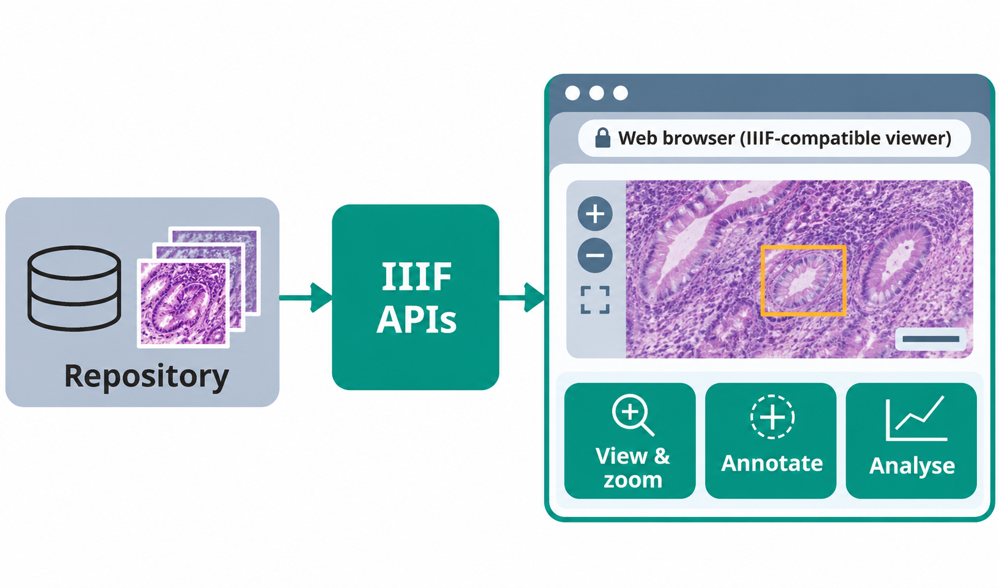

# Make your image datasets easier to view and reuse {.cover-slide}

::: {.cover-subtitle}
**International Image Interoperability Framework** (IIIF) service from 4TU.ResearchData
:::

::: {.cover-mark aria-hidden="false"}
IIIF
:::

::: {.bottom-line}

Leila Iñigo de la Cruz  
*Digital skills trainer at 4TU.ResearchData*  
3 December 2026, Amsterdam Imaging Hub

:::

# Motivation 

## Downloading the files should not be the **only** way to explore visual research data.

::: {.fragment}

### Traditional approach to view/inspect deposited research data e.g. images

{width=80%}

:::

<!-- ::: {.fragment}
- Find a file in a dataset record
- Download the original image
- Open it in suitable software
::: -->

::: {.fragment}

- **slow, inconvenient, and sometimes impossible** since it depends on local storage capacity.
- **not interoperable**: it does not allow you to *connect* the data with other tools.
 

:::

# What could be an **alternative approach**?

## Retrieve and view the images **directly in a browser** without downloading them first.

::: {.fragment}
{width=82%}
::: 

<!-- Slide from 02-what-is-iiif.qmd -->

# What is IIIF?

:::{.fragment}

::: {.definition}
**IIIF = International Image Interoperability Framework**

An open set of **web standards** that allows repositories, libraries, archives, museums, and research services to publish images in a way that many tools can understand.
:::

:::

::: {.question-grid}
::: {.question-item .fragment}
01

How can I inspect a **very large image** in a browser?
:::

::: {.question-item .fragment}
02

How can I request a **region, size, or zoom level**?
:::

::: {.question-item .fragment}
03

How do I describe a **sequence or collection** of images?
:::

::: {.question-item .fragment}
04

How can I **aggregate** images from different sources?
:::
:::

<!-- Slide from 03-two-apis.qmd -->

# How does IIIF work? 

## The basic idea: two complementary APIs

::: {.api-pair}

::: {.api-column .fragment fragment-index="1"}

Retrieving visual content

### Image API

Standard requests for a particular version of an image.

::: {.api-actions}
Thumbnail
Crop / region
Resize / deep zoom
:::

:::

::: {.api-join .fragment fragment-index="1"}
+
:::

::: {.api-column .fragment fragment-index="2"}

Describing visual content

### Presentation API

A **manifest** describing which images belong together and how to display them.

::: {.api-actions}
Labels & order
Metadata
Image-service links
:::

:::

:::

::: {.bottom-line .fragment fragment-index="3"}

**Image API:** *give me the pixels.* &nbsp; 
**Presentation API:** *tell me what I am looking at.*

:::

<!-- Slide from 05-what-is-manifest.qmd -->

# But, how does a viewer know which images to display ?

::: {.fragment fragment-index="1"}

::: {.col}
A IIIF manifest is a structured **JSON-LD** document, defined by the Presentation API, that describes:

- **What** the images represent.
- **Which** images belong together and in what order.
- **Where** and how to retrieve them.
- **What** metadata and annotations are associated with them.

:::

:::

::: {.bottom-line .fragment fragment-index="2"}

The Manifest does not contain the images.
It describes and connects them.

:::

# Do you know what is json-ld?

::: {.fragment fragment-index="1"}

JSON-LD (JavaScript Object Notation for Linked Data) is a standard for representing structured, machine-readable and interconnected information on the web.

- JSON provides the structure of the document.
- Linked Data provides a shared meaning to its elements and allows references to other web resources.
- IIIF defines a common vocabulary and data model that compatible applications can interpret.

:::

<!-- Slide from 06-research-examples.qmd -->

<!-- Slide from 07-from-manifest-to-viewer.qmd -->

## From a dataset to an IIIF viewer

::: {.steps-horizontal}
::: {.step-item}
1

### Find

Open a dataset page on 4TU.ResearchData.
:::

::: {.step-arrow}
→
:::

::: {.step-item}
2

### Copy

Copy the **IIIF Manifest** URL under *Interoperability*.
:::

::: {.step-arrow}
→
:::

::: {.step-item}
3

### Explore

Paste the manifest URL into an IIIF-compatible viewer.
:::
:::

::: {.emphasis-statement}
One standard URL can open the same dataset in multiple compatible tools.
:::

<!-- Slide from 08-what-manifest-enables.qmd -->

# Lets practice! 

## Examples from 4TU.ResearchData

::: {.examples-three}
::: {.example}
01 / Microscopy

### Large microscopy images

29 GB TIFF

High-throughput single-molecule microscopy images. Preview and inspect large files before downloading.

[View dataset](https://data.4tu.nl/datasets/bcf01712-4f8d-4f12-bfc6-84fed4ddc086){.small-link}
:::

::: {.example}
02 / Cartography

### Port City Atlas maps

104 files PDF

High-resolution maps for preview, comparison, teaching, and potential georeferencing workflows.

[View dataset](https://data.4tu.nl/datasets/8289a903-7ccf-401b-af66-f5b3c9abe4b6){.small-link}
:::

::: {.example}
03 / Machine learning

### Antarctic image segmentation

5.9 GB TIFF

Historical Antarctic aerial images and labels used to train semantic-segmentation workflows.

[View dataset](https://data.4tu.nl/datasets/052fa1dc-cf10-4bef-8b64-aeda99fbe3a4){.small-link}
:::
:::

<!-- Slide from 09-iiif-tool-ecosystem.qmd -->

## Different tools, same standard

::: {.tool-groups}
::: {.tool-group}
View, browse & compare

- [Mirador](https://projectmirador.org/) — multi-image comparison and annotation
- [Universal Viewer](https://universalviewer.io/) — general-purpose IIIF viewer
- [Clover IIIF](https://samvera-labs.github.io/clover-iiif/) — Presentation API viewer
:::

::: {.tool-group}
Build & enrich

- [Annona](https://ncsu-libraries.github.io/annona/) — web display and annotations
- [OpenSeadragon](https://openseadragon.github.io/) — deep-zoom image viewing
- [Allmaps](https://allmaps.org/) — georeferencing IIIF maps
- [Digirati Manifest Editor](https://manifest-editor.digirati.services/) — inspect and edit manifests
:::
:::

::: {.bottom-line}
Not every viewer supports every IIIF feature: choose the tool that fits your workflow.
:::

## When is IIIF especially useful?

::: {.lead}
Whenever **visual inspection** is an important step in understanding the dataset.
:::

::: {.usecases}
::: {.usecase}
01

**High-resolution microscopy**

Explore fine detail at different zoom levels
:::

::: {.usecase}
02

**Maps, scans & drawings**

Compare and inspect spatial or historical resources
:::

::: {.usecase}
03

**Collections for teaching & analysis**

Enable annotation and reuse across platforms
:::
:::

<!-- Slide from 12-requirements.qmd -->

# Now, what do you need to deposit your images with IIIF access in 4TU.ResearchData?

## First: expose the images as **individual files** in the dataset, not as a single ZIP archive.

::: {.lead}
IIIF works best when images can be accessed **individually**, not only as files hidden inside an archive.
:::

::: {.file-choice}
::: {.file-good}
Recommended for IIIF access

### Individual image files

TIFFJPEGPNGJPEG 2000PDF*

Each image can be addressed, inspected, and served separately.
:::

::: {.file-bad}
Avoid as the only deposit

### ZIP-only image collection

images.zip

Files inside a ZIP cannot be served individually through IIIF.
:::
:::

::: {.small-note}
*PDF support depends on the ability to render or expose its pages as images. You can provide a ZIP for convenience **alongside** separately exposed files.
:::

<!-- Slide from 13-good-practices.qmd -->

## Good practices for depositing images

:::{.fragment}

::: {.checklist-columns}
::: {.checklist-column}
- [x] Deposit the relevant images as **individual files**.
- [x] Use **clear, consistent filenames**, especially for sequences.
- [x] Include a **README** describing content, provenance, and research context.
:::

::: {.checklist-column}
- [x] Provide useful metadata: **scale, sample, time, location, instrument**, when applicable.
- [x] Prefer **open, well-documented formats**.
- [x] Check the images **open in standard software** before depositing.
:::
:::

:::

:::{.fragment}

::: {.bottom-line}
Better documentation and metadata make the resulting IIIF manifest more useful.
:::

:::

<!-- Slide from 14-what-iiif-does-not-do.qmd -->

# What IIIF does **not** do

::: {.limitations}
::: {.limitation}
× Change the scientific content of the files
:::
::: {.limitation}
× Validate scientific correctness or data quality
:::
::: {.limitation}
× Replace a README, methods, or domain-specific metadata
:::
::: {.limitation}
× Replace licensing or access-condition decisions
:::
::: {.limitation}

× Automatically support every proprietary image format
:::
:::

# How IIIF deals with different image formats

::: {.incremental}

- IIIF does not prescribe how images must be stored.

- The image server must be able to decode
  the original file format.

- The viewer receives a standardised image
  representation, regardless of the source format.

- Scientific information may be lost when
  generating a visual representation. For instance, a proprietary microscopy file may (e.g. .nd2,.lif,.czi) contain multiple fluorescence channels, multidimensional arrays and acquisition metadata. Delivering a JPEG representation through IIIF does not necessarily preserve all that scientific information.

:::

::: {.bottom-line .fragment}

**IIIF standardises how we access images,
not how we store them. **

::: 

## References and further reading

::: {.columns}

::: {.column width="50%"}

### IIIF

- [IIIF Consortium](https://iiif.io/)
- [Image API 3.0](https://iiif.io/api/image/3.0/)
- [Presentation API 3.0](https://iiif.io/api/presentation/3.0/)
- [IIIF Cookbook](https://iiif.io/api/cookbook/)
- [IIIF Training Materials](https://training.iiif.io/)

### Practical tools

- [Digirati Manifest Editor](https://manifest-editor.digirati.services/)
- [Theseus Viewer](https://theseusviewer.org/)
- [Manifest Editor Documentation](https://manifest-editor-docs.netlify.app/)

:::

::: {.column width="50%"}

### 4TU.ResearchData

- [4TU.ResearchData Repository](https://data.4tu.nl/)
- [WebAPI Documentation](https://data.4tu.nl/api/docs)
- [Djehuty Documentation](https://djehuty.4tu.nl/)
- [Preferred File Formats](https://data.4tu.nl/s/documents/Preferred_File_Formats_2023.pdf)

### Open and standardised formats

- [4TU.ResearchData Preferred Formats](https://data.4tu.nl/s/documents/Preferred_File_Formats_2023.pdf)
- [Library of Congress Recommended Formats](https://www.loc.gov/preservation/resources/rfs/)
- [Open Microscopy Environment](https://www.openmicroscopy.org/)
- [Bio-Formats: The solution for reading proprietary microscopy image data and metadata](https://www.openmicroscopy.org/bio-formats/)

:::

:::

# Thanks!!